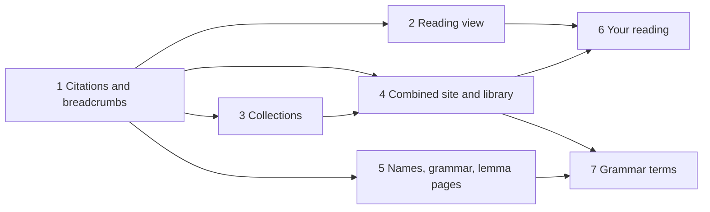

# Navigation plan

This plan turns the three separate readers (Edda, Gītā, Aeneid) into one site with five levels of
navigation: library › reader › collection › work › line. It follows the wireframes agreed on
2026-10-31. The phases are ordered so that each one ships on its own and leaves every reader working.

## Decisions

| Decision | State | Notes |
|---|---|---|
| Name of the whole site | Working name | "Classics Reader" (`classics-reader`) on the library page and as the first breadcrumb until a final name is chosen. Keep it in one place (the library layout) so a rename touches one file. |
| Domain | Settled | `classics-reader.solforged.io`, set as `site` in `astro.config.mjs`. Readers live under `/edda/`, `/gita/`, `/aeneid/`. The host is chosen when Phase 4 is first deployed. |
| Licence wording | Deferred | The Aeneid's LASLA data is CC BY-NC-SA. Each reader's sources page already states its licences; site-wide wording waits until the site is published. |

## Phase 1: Citations and breadcrumbs

Status: done (2026-11-01). The go-to box also accepts the abbreviation's own notation inside the
open work (`Aen. 1.305`).

These shared pieces are needed by every later phase, and they work within a single reader.

1. **Citation formatting.** Add `src/lib/cite.ts` with `formatCite(work, cite)`. When a work has
   more than one citation level and its `abbr` already ends with the first level's value, the value
   is not repeated. This fixes the concordance and the copy-link toast, which today print
   `Aen. 1 1.742`. Use it in `src/pages/lexicon/[lemma].astro` (the concordance `ref`) and in
   `src/scripts/reader.ts` (`toast` in the citation-link handler).
2. **Citation parsing.** Add `resolveCite(input, works)` to the same module. It normalizes case,
   dots and separators (`1 23`, `1:23`, `1,23`), matches the longest work abbreviation, and returns
   `{ slug, cite }`. `Vsp 45` resolves to `voluspa`, `45`; `Aen. 1.157` to `aeneid-1`, `1.157`;
   `BhG 2.47` to `bhagavad-gita-2`, `47`. A bare number keeps today's meaning: a row or line in the
   open work. The repository has no tests yet; this function justifies the first one
   (`src/lib/cite.test.ts`, `bun test`), because its cases are easy to break: abbreviations
   that are prefixes of others, works whose `abbr` includes a number, and inputs that match nothing.
3. **Go-to box.** The reader's go-to form accepts a full citation. When it names another work in
   the same reader, the form navigates to `<slug>/#<cite>`; when it matches nothing, it opens search
   with the input.
4. **Breadcrumb switchers.** Extend the `crumbs` prop of `src/layouts/Base.astro` with an optional
   `siblings: { href, label, current }[]`. A crumb with siblings renders as a button and a
   `popover` list (no script needed). The reader page passes the other works of its
   collection; the lemma page passes nothing new. Remove `#work-select` and its listener in
   `reader.ts`.
5. **Shared theme key.** Store the theme under `theme` instead of `<reader>-theme` (`Base.astro`,
   inline script and toggle), reading the old key once as a fallback so a stored choice survives.
   The script, view and reading-position keys stay per reader.

Acceptance: the Aeneid concordance reads `Aen. 1.742`; typing `Háv 77` in Völuspá opens Hávamál at
stanza 77; the work crumb lists the collection's works. Edda and Gītā generated data is unchanged
(skill `eddas-reader-refactor-equivalence`); the only page differences are the breadcrumb trail,
the toolbar and citation text.

## Phase 2: Reading view

Status: done (2026-11-01). The outline lives in `src/components/WorkPage.astro`.

1. **Outline rail.** Build a per-work outline in `src/pages/[slug]/index.astro`:
   - Listed levels (Prose Edda chapters): one entry per division. This replaces the `.chapters` strip.
   - Numbered stichic verse (Aeneid paragraphs): the first line number and the first three words of
     the line, taken from `SourceUnit.firstLine` and the line's pieces.
   - Stanzaic poems: no entries for individual stanzas; the go-to box serves that purpose.
   - Below the outline: the other works of the same collection.

   The rail stands beside the text from 1280 px wide while the word panel is closed, and from
   1680 px with it open; otherwise it opens as a sheet from an "Outline" button in the toolbar. The
   current entry is highlighted by the `IntersectionObserver` that already records the reading
   position.
2. **Position bar.** Replace `.work-nav` with a bar that holds the previous and next outline entry,
   a progress bar (how far the reader has scrolled through the text), and the previous and next
   work. Works without an outline show only the progress bar and the previous and next work.
3. **Word-panel history.** Keep a back stack of shown words in `reader.ts` (`showWord`). The
   panel header shows the previous word as a back link. The stack resets when the panel closes.

Acceptance: in Aeneid 1 the rail lists Greenough's 39 paragraphs with first words and tracks the
scroll position; a Prose Edda work's chapters appear in the rail and the strip is gone; clicking two words
and pressing back in the panel restores the first. Browser check at 1280 and 390 px wide.

## Phase 3: Collections

Status: done (2026-11-01).

1. **Site contract.** Add `collections: { id, title, subtitle, intro }[]` to `ReaderSite`
   (`src/sites/types.ts`) and change `WorkInfo.collection` from a display string to a collection
   id. Update the three `corpora/*/site.ts` files. The work header's eyebrow uses the collection
   title.
2. **Collection page.** Only readers with more than one collection get collection pages. Of the
   current readers, that is the Edda (Poetic Edda, Prose Edda). Serve them from the existing
   `src/pages/[slug]/index.astro` route: `getStaticPaths` returns works and collections with a
   `kind` prop, and the route renders `WorkPage.astro` or `CollectionPage.astro`. A second dynamic
   route at the same segment would make Astro choose between them by priority, so one route is the
   safer arrangement. The site build (`src/lib/site.ts`) fails if a collection id equals a work
   slug or a work names an unknown collection.
3. **Reader home.** `src/pages/index.astro` lists collections (when there are several), each with
   its groups, instead of groups alone. Readers with one collection look as they do now.
4. **Breadcrumbs.** Reader › collection › work when there are several collections; reader ›
   work otherwise. The collection crumb's siblings are the other collections.

Acceptance: `/poetic-edda/` lists the mythological and heroic poems with summaries; the Gītā and
Aeneid homes are unchanged apart from the shared header. Edda data unchanged except `collection`
fields.

## Phase 4: Combined site and library

1. **Base paths.** `astro.config.mjs` reads `BASE` (default `/`) and sets `base` and
   `outDir: dist/site/<reader>` when it is set. All links already go through `BASE_URL` (no
   hard-coded root paths in `src/`), so no page changes are expected. Per-reader `dev` and
   `build` keep working at `/`.
2. **Library build.** A second Astro config, `astro.library.mjs`, with `srcDir: "library"` and
   `outDir: "dist/site"`, sharing `src/styles/global.css`. Its layout is a small copy of
   `Base.astro` without the language pack. `library/pages/index.astro` lists the readers by
   language with their work counts and links to them.
3. **Citation index.** `scripts/library.ts` imports `src/sites/registry.ts` and every
   `corpora/<id>/site.ts` and writes `generated/library/citations.json`, mapping each reader to
   its works with `slug`, `abbr` and `levels`. The library build publishes it at
   `/citations.json`. The go-to box in every reader fetches it lazily and uses `resolveCite` across
   readers. When the file is absent (a single reader in development), go-to stays within the reader.
4. **Library breadcrumb.** The first crumb in every reader becomes the library, with the other
   readers as siblings. It appears only when `BASE` is set.
5. **Continue reading.** The library page reads each reader's `<id>-last` key (the keys
   already include the reader id, so they can share one origin) and shows the most recent
   position. Reading positions need a timestamp to compare: add `at` to the stored object in
   `reader.ts`.
6. **Scripts.** `build:site` runs the data build for each reader (when data is stale is the caller's
   concern, as now), each reader's `astro build` with `BASE=/<id>/`, then the library build.
   `preview:site` serves `dist/site`.

Acceptance: `bun run build:site && bun run preview:site` serves the library at `/` and the three readers at
`/edda/`, `/gita/`, `/aeneid/`; `Aen. 1.157` typed in the Edda reader opens the Aeneid at
line 157; each reader's own bundle still contains only its own language pack (check `dist/site/<id>/_astro`).

## Phase 5: Names, grammar and lemma pages

1. **Names.** `src/pages/names/index.astro`: the reader's proper-noun lemmas (`PROPN` in
   `lexicon.json`: 823 in the Edda, 154 in the Aeneid, none in the Gītā, whose source tags names as
   nouns) grouped by initial, with gloss and count, linking to lemma pages. Edda entries take
   Bellows's identifications (`NameGloss.desc`, e.g. "Sigurth's horse"). The top-bar link appears
   only when the reader has names.
2. **Grammar.** `src/pages/grammar/index.astro` for packs with tables: one model table per
   inflection class (`Paradigm.kind`, headed by `lang.tables.heading`) and the lemmas of the corpus
   in that class. The data build writes `generated/<id>/data/grammar.json` (kind → lemmas) from
   the paradigm shards. The Edda gets it now; the Latin pack gets it when it gets tables.
3. **Lemma pages.** Add compound parts from `DictHit.parts` (Edda only), and limit the
   concordance to one work with a filter on the existing "Frequency by work" list.

Acceptance: the Edda Names page lists Grani with Bellows's gloss; the Grammar page shows a strong
neuter a-stem model with *hljóð* among its lemmas; the Aeneid shows Names and no Grammar link.

## Phase 6: Your reading

1. **Storage.** `localStorage` only, per reader: `<id>-bookmarks` (citations with time),
   `<id>-progress` (furthest row index per work), `<id>-words` (lemma and page slug).
2. **Controls.** A bookmark button in the reader toolbar and on each row's citation link; "Add to word list" in the word
   panel.
3. **Pages.** `src/pages/you/index.astro` in each reader: bookmarks, works in progress, and the
   word list with a download as CSV. The collection page and reader home mark works as read or in
   progress from `<id>-progress`. The library page links to each reader's page.

Acceptance: a bookmark and a saved word survive a reload and appear on the page; clearing site data
empties it without errors.

## Phase 7: Grammar terms

1. **Glossary.** `library/pages/terms/index.astro`: short definitions of the morphology labels the packs'
   `describeMorph` produce (deponent, mediopassive, aorist, dual, optative, …), written for this
   site. The labels are gathered by a build check that fails when a pack emits a label without a
   definition.
2. **Links.** Morphology labels in the word panel and on lemma pages link to their definitions.
   In a single-reader development build, the links point to the reader's own copy of the page.

Acceptance: every label a pack emits has a definition; clicking "deponent" in the Aeneid panel
opens its definition.

## Verification for every phase

- `bun run typecheck`; data and site builds for all three readers.
- Equivalence against the previous commit (skill `eddas-reader-refactor-equivalence`). Every
  change in generated data or pages must be one the phase intends.
- Headless browser check of the phase's acceptance items at desktop and phone widths, with no
  console errors.
- README: update the layout and building sections as routes and scripts are added.
